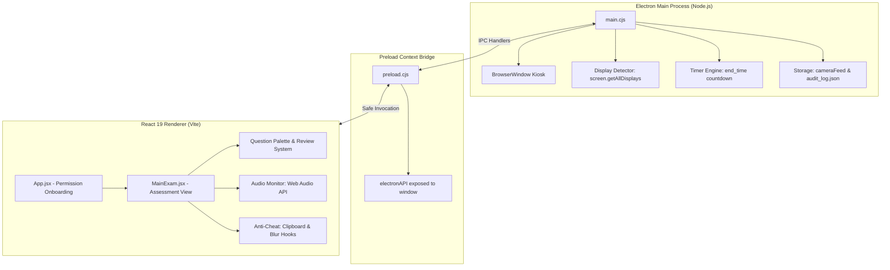

# 🏛️ myAthena - Secure Examination & Proctoring Desktop Platform

**myAthena** is an enterprise-grade desktop assessment environment built on **Electron**, **React 19**, and **Vite 8**. It provides a secure, lockdown examination platform with real-time hardware verification, automated proctoring surveillance, and anti-cheating mechanisms.

---

## 🚀 Key Features

### 🛡️ Anti-Cheating & Lockdown Security
* **Kiosk Mode Lock**: Enforces a borderless fullscreen kiosk lockdown window to prevent desktop multi-tasking.
* **Secondary Monitor Detection**: Queries native display adapters (`screen.getAllDisplays()`) and prevents test access if external screens or HDMI projectors are connected.
* **Window Focus & Tab Switch Strikes**: Tracks window focus loss (`blur`/`visibilitychange`). Candidates receive formal security violation strikes with auto-termination upon 3 strikes.
* **Clipboard & Shortcut Protection**: Disables `Copy`, `Cut`, `Paste`, text selection, right-click context menu, and dangerous keys (`F12`, `Ctrl+Shift+I`, `Ctrl+R`, `F5`, `Ctrl+P`).

### 👁️ Proctoring & Surveillance
* **Live Webcam PIP Badge**: Floating Picture-in-Picture webcam feed with a pulsing "LIVE PROCTORING" indicator.
* **Periodic Proctor Snapshots**: High-resolution frames captured every 5 seconds and written to disk (`cameraFeed/<timestamp>.jpeg`).
* **Ambient Audio Monitoring**: Web Audio API analyzer detects speech and noise spikes in the testing environment.
* **Persistent Audit Logging**: Every session event (test start, snapshots, blur violations, noise spikes, submissions) is appended with ISO timestamps to `cameraFeed/audit_log.json`.

### 📝 Assessment Engine
* **Interactive Question Palette**: Visual grid showing real-time question statuses:
  * 🟩 **Answered**
  * 🟪 **Marked for Review** (with star badge)
  * 🟧 **Visited but Unanswered**
  * ⬜ **Unvisited**
* **Answer Controls**: Next/Previous navigation, "Clear Answer", and "Mark for Review" toggles.
* **Tamper-Proof Timer**: Countdown time calculated in the Electron main process to prevent client-side time manipulation; automatically triggers final submission when reaching `00:00:00`.
* **Submission Confirmation Modal**: Summary breakdown (answered, unanswered, flagged) before final submission, followed by a secure Completion Screen.

---

## 🏗️ Architecture Overview



---

## 🛠️ Installation & Setup

### Prerequisites
* **Node.js** v18+
* **npm** v9+

### 1. Install Dependencies
```bash
npm install
```

### 2. Start in Unified Development Mode
Runs Vite and launches Electron concurrently:
```bash
npm run dev:all
```

*Or manually in two terminals:*
```bash
# Terminal 1: Vite Dev Server
npm run dev

# Terminal 2: Electron Application
npm start
```

### 3. Production Build
```bash
npm run build
```

---

## 📊 IPC Protocol Table

| Channel | Direction | Description |
|---|---|---|
| `full-screen` | Renderer $\rightarrow$ Main | Engages Electron kiosk mode |
| `check-displays` | Renderer $\rightarrow$ Main | Returns connected monitor count and display metrics |
| `start-test` | Renderer $\rightarrow$ Main | Sets authoritative exam end time |
| `get-time` | Renderer $\rightarrow$ Main | Retrieves remaining time in milliseconds |
| `show-rules` | Renderer $\rightarrow$ Main | Displays native rules acknowledgment dialog |
| `save-photo` | Renderer $\rightarrow$ Main | Saves webcam snapshot buffer to `cameraFeed/` |
| `log-audit-event` | Renderer $\rightarrow$ Main | Appends timestamped security event to `audit_log.json` |
| `window-blur-detected` | Main $\rightarrow$ Renderer | Notifies exam UI of window focus loss |

---

## 📄 License
Private assessment software. All rights reserved.
